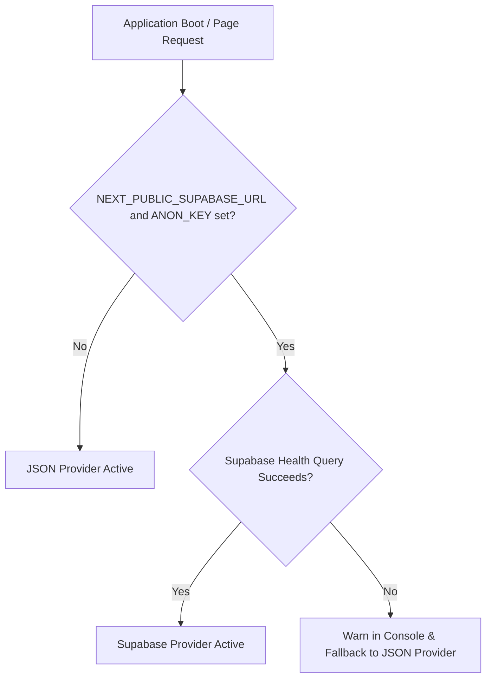

# CARRYFORM — Supabase Integration & Database Setup Guide

CARRYFORM comes pre-architected with **dual-mode data resolution**:
1. **JSON Demonstration Mode (Default)**: Runs without any database credentials using the verified catalogue in `src/data/`.
2. **Supabase Production Mode**: Connects seamlessly to a PostgreSQL database hosted on Supabase when valid environment variables are provided.

This guide provides end-to-end instructions for configuring your own Supabase project, executing the database migrations, seeding initial catalogue records, and understanding Row Level Security (RLS).

---

## 1. Architectural Overview & Safe Fallback

CARRYFORM includes an automatic provider resolver in `src/lib/data/index.ts`:



- If Supabase environment variables are missing, the application **never crashes**; it uses local JSON data.
- If Supabase environment variables are provided but the project is unreachable or tables are unmigrated, CARRYFORM logs a warning and **falls back gracefully to JSON mode**.

---

## 2. Step 1: Create a Free Supabase Project

1. Visit **[https://supabase.com](https://supabase.com)** and sign in or create an account.
2. Click **New Project** and select your preferred organization.
3. Choose a project name (e.g. `carryform-showroom`).
4. Generate or enter a secure database password (save this in a secure password manager).
5. Select a region close to your primary audience (e.g. `ap-south-1` for India / Mumbai, or `us-east-1` for North America).
6. Click **Create new project** and wait ~2 minutes for provisioning to complete.

---

## 3. Step 2: Retrieve API Credentials

Once your project is ready:

1. Navigate to **Project Settings** (gear icon in the left sidebar) -> **API**.
2. Locate the following two values under **Project API keys**:
   - **Project URL**: e.g. `https://xyzcompany.supabase.co`
   - **anon / public key**: A long JWT string or modern publishable key starting with `sbp_` or `eyJ...`.
3. Locate the **service_role key** (under Project API keys -> Secret keys).
   > [!CAUTION]
   > **CRITICAL SECURITY REQUIREMENT**:
   > - The `anon` key is safe to expose in browser code and client bundles. Row Level Security (RLS) protects your data.
   > - The `service_role` key **BYPASSES ALL ROW LEVEL SECURITY**. It must **NEVER** be prefixed with `NEXT_PUBLIC_` and must **NEVER** be imported into client components. Keep it strictly server-only.

---

## 4. Step 3: Configure Local Environment Variables

1. In your local project root, create a file named `.env.local` by copying the template:
   ```bash
   cp .env.example .env.local
   ```
2. Open `.env.local` and paste your project credentials:
   ```env
   NEXT_PUBLIC_SITE_URL=https://carryform.in

   # Your Supabase Project REST Endpoint
   NEXT_PUBLIC_SUPABASE_URL=https://your-project-id.supabase.co

   # Your Supabase Anonymous / Publishable Key (safe for browser)
   NEXT_PUBLIC_SUPABASE_ANON_KEY=eyJhbGciOi...your-anon-key...

   # Optional Server-Only Service Role Key (Keep private!)
   SUPABASE_SERVICE_ROLE_KEY=eyJhbGciOi...your-service-role-key...
   ```
3. Save the file. `.env.local` is already ignored by Git in `.gitignore` to prevent leaking credentials.

---

## 5. Step 4: Execute Database Migration

CARRYFORM provides an idempotent migration script at `supabase/migrations/0001_initial_schema.sql`.

You can apply it using either **Option A (Supabase Dashboard SQL Editor)** or **Option B (Supabase CLI)**.

### Option A: Via Supabase Dashboard (Recommended for beginners)

1. Open your Supabase project dashboard in your browser.
2. Click on **SQL Editor** in the left sidebar.
3. Click **+ New query**.
4. Open the file `supabase/migrations/0001_initial_schema.sql` from your CARRYFORM folder, copy its complete contents, and paste it into the SQL Editor.
5. Click **Run** (or press `Ctrl+Enter` / `Cmd+Enter`).
6. You will see:
   ```
   Success. No rows returned.
   ```
7. Click on **Table Editor** in the left sidebar to verify that the following 7 tables were created:
   - `categories`
   - `collections`
   - `products`
   - `product_images`
   - `product_variants`
   - `site_settings`
   - `contact_messages`

### Option B: Via Supabase CLI (For developers)

1. Ensure the Supabase CLI is installed (`npm install -g supabase`).
2. Login to Supabase:
   ```bash
   npx supabase login
   ```
3. Link your local directory to your remote project:
   ```bash
   npx supabase link --project-ref your-project-id
   ```
4. Push migrations:
   ```bash
   npx supabase db push
   ```

---

## 6. Step 5: Seed Demonstration Data (Optional)

To populate your Supabase database with the 20 verified CARRYFORM demo products, collections, categories, and editorial copy:

1. Open **SQL Editor** in the Supabase Dashboard.
2. Click **+ New query**.
3. Open `supabase/seed.sql` in your editor, copy all text, paste it into the SQL Editor, and click **Run**.
4. Navigate to **Table Editor -> products**. You should see 20 products populated with active statuses, images, and specifications.

---

## 7. Understanding Row Level Security (RLS) Policies

All tables have Row Level Security enabled:

| Table | Anonymous Visitor (anon) | Authenticated Admin | Notes |
|---|---|---|---|
| `categories` | Read-only (where `is_active = true`) | Full CRUD | Public catalogue access |
| `collections` | Read-only (where `is_active = true`) | Full CRUD | Public collection doors |
| `products` | Read-only (where `is_active = true`) | Full CRUD | Public product showcase |
| `product_images` | Read-only (for active products) | Full CRUD | Image gallery display |
| `product_variants` | Read-only (for active products) | Full CRUD | Variant swatches |
| `site_settings` | Read-only (`select`) | Full CRUD | Brand & contact details |
| `contact_messages` | Insert-only (`insert`) | Read & Update (`select, update`) | Enquiries submitted via contact form |

Anonymous visitors cannot write, edit, or delete any catalogue records.

---

## 8. Verifying Connection

Restart your Next.js development server:
```bash
npm run dev
```

Inspect your terminal output. When Supabase is successfully linked, you will see:
```
[CARRYFORM] Supabase health check passed — using Supabase provider.
```

If you ever wish to temporarily revert back to JSON demonstration mode without deleting your Supabase project, simply comment out or unset `NEXT_PUBLIC_SUPABASE_URL` in your `.env.local` file and restart the server.
